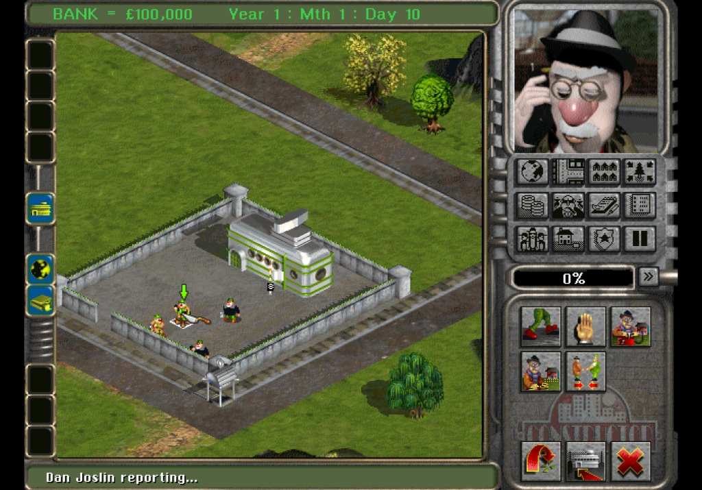
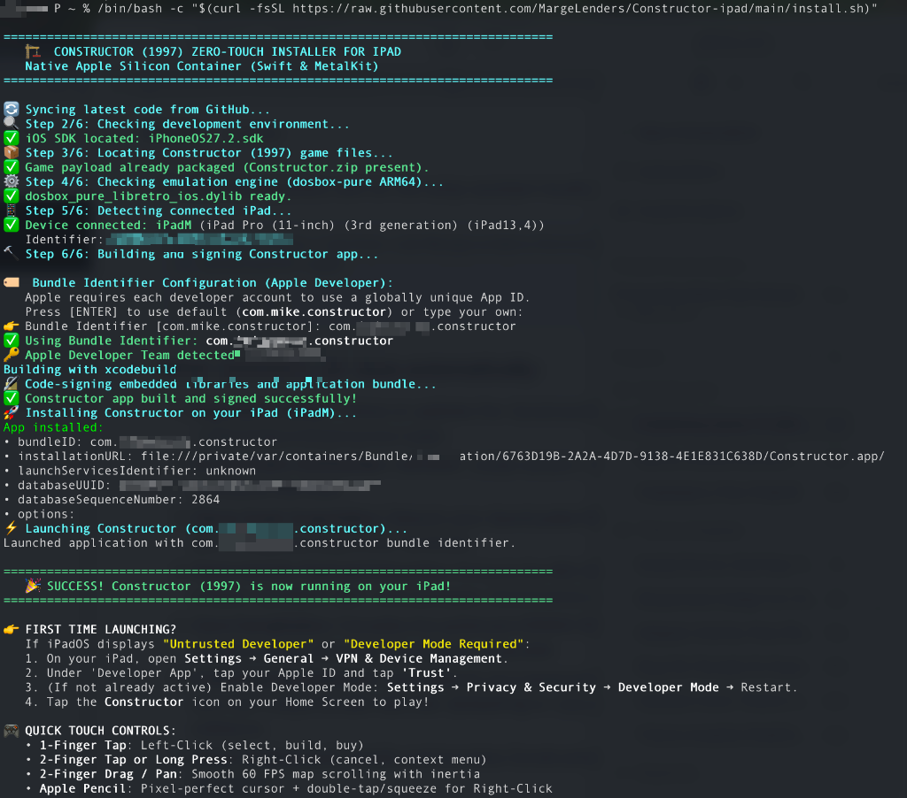

# Constructor (1997)
### Contenedor Nativo Apple Silicon para iPadOS y macOS (`arm64`)

> *"¡Tienes mucho trabajo de construcción por delante!"*

<p align="center">
  
</p>

[](https://developer.apple.com)
[-orange.svg)](https://www.apple.com)
[](https://developer.apple.com/metal/)
[](https://developer.apple.com/av-foundation/)
[](LICENSE)
[](README.md)

> 📖 *Read in [English](README.md)*

Contenedor nativo de alto rendimiento escrito en **Swift y Metal** que ejecuta el clásico juego de estrategia y gestión inmobiliaria **Constructor (System 3, 1997)** directamente sobre la arquitectura **Apple Silicon (`arm64`)** en iPad y Mac.

El juego se ejecuta como una aplicación moderna de iPadOS: **sin emuladores visibles, sin ventanas intermedias de DOS y sin crucetas virtuales en pantalla**. Ofrece arranque instantáneo, renderizado acelerado por hardware a pantalla completa, audio estéreo de muy baja latencia y un intuitivo **sistema de control táctil directo 1:1** diseñado específicamente para pantallas táctiles y Apple Pencil.

---

## 🌟 Características Destacadas

- **🎮 Control Táctil Directo 1:1 (Sin mandos ni crucetas virtuales en pantalla):**
  - **Toque con 1 dedo / Apple Pencil**: Clic izquierdo inmediato (seleccionar obreros, construir edificios, interactuar con menús).
  - **Toque con 2 dedos o Pulsación larga**: Clic derecho con confirmación por **vibración háptica**.
  - **Arrastre con 2 dedos**: Paneo del mapa ultrasuave a **60 FPS con inercia y física**.
  - **Soporte Apple Pencil**: Gestos nativos de doble toque o presión (*squeeze*) para clic derecho.
  - **Periféricos Externos**: Compatibilidad total con **Magic Keyboard**, ratón y trackpad Bluetooth.
- **⚡ Pipeline Gráfico en Metal:**
  - Renderizado acelerado por GPU en MetalKit con **filtro Sharp-Bilinear** (mantiene los gráficos isométricos nítidos en pantallas Liquid Retina y ProMotion sin desenfoque bilineal).
  - Conmutación dinámica de resolución (320×200 en cinemáticas/menús $\rightarrow$ 640×480 SVGA en partida).
  - Corrección de aspecto 4:3 con bandas negras laterales automáticas (*pillarboxing*).
- **🔊 Motor de Audio Sound Blaster 16:**
  - Integración con CoreAudio mediante un **Ring Buffer lock-free** atómico sincronizado con `AVAudioSourceNode` a 44.100 Hz estéreo, eliminando chasquidos y desfases.
- **💾 Gestión de Partidas Guardadas:**
  - Integración nativa con la app **Archivos (Files)** de iPadOS (`UIFileSharingEnabled` habilitado) para respaldar o transferir tus partidas en cualquier momento.
- **🚀 Instalador Zero-Touch Automatizado:**
  - Asistente interactivo (`install.sh`) que verifica tu entorno, extrae automáticamente tu instalador de GOG, compila el núcleo de emulación ARM64, firma la aplicación y la instala directamente en tu iPad conectado.

---

## 📋 Requisitos Previos

Para compilar e instalar el juego en tu iPad o Mac necesitarás:

1. **Ordenador Mac:** Con macOS Sonoma (14.0+) o Sequoia (15.0+) sobre Apple Silicon o Intel.
2. **Xcode 15+:** Instalado desde la Mac App Store o portal de desarrolladores de Apple.
   - Herramientas de línea de comandos configuradas: `sudo xcode-select -s /Applications/Xcode.app/Contents/Developer`
   - Licencia aceptada: `sudo xcodebuild -license accept`
3. **iPad:** Con iPadOS 17.0+ (iPad Pro, iPad Air, iPad mini, o iPad estándar) con **Modo Desarrollador** activado (*Ajustes → Privacidad y seguridad → Modo Desarrollador*).
4. **Apple ID:** Una cuenta gratuita personal de Apple ID sirve perfectamente (no se requiere suscripción anual de $99).
5. **Copia legal de Constructor (1997):**
   - Disponible en [GOG.com](https://www.gog.com/game/constructor).
   - Descarga el instalador para Mac (`constructor_en_2.0.0.14.pkg`) o ten a mano tus archivos originales de MS-DOS.

---

## 🚀 Inicio Rápido (Instalación Automatizada Zero-Touch)

Conecta tu iPad al Mac mediante cable USB y ejecuta este único comando en tu **Terminal**:

```bash
/bin/bash -c "$(curl -fsSL https://raw.githubusercontent.com/MargeLenders/Constructor-ipad/main/install.sh)"
```

O clona el repositorio y ejecuta el asistente en local:

```bash
git clone https://github.com/MargeLenders/Constructor-ipad.git
cd Constructor-ipad

./install.sh
```

<p align="center">
  
</p>

### ¿Qué realiza `install.sh` automáticamente?
1. **Configuración del Repositorio:** Descarga o sincroniza `Constructor-ipad` en `~/Developer/Constructor-ipad`.
2. **Comprobación del Entorno:** Valida `xcode-select`, SDKs de iOS (`iphoneos`) y herramientas de terminal.
3. **Detección del Juego:** Detecta el instalador `.pkg` de GOG en `~/Downloads` (o te permite arrastrarlo al Terminal).
4. **Extracción Determinista del Payload:** Extrae la ISO del CD, música, directorios DOS, genera `AUTOBOOT.DBP` y empaqueta `Constructor.zip`.
5. **Compilación del Núcleo:** Compila en paralelo el núcleo DOSBox-Pure para ARM64 (`dosbox_pure_libretro_ios.dylib`).
6. **Asistente de Firma de Código:** Detecta tu identidad personal de Apple Development en Keychain y te permite indicar tu propio Bundle Identifier único (por defecto `com.<tu_usuario>.constructor`) para evitar colisiones con otros desarrolladores.
7. **Instalación Directa:** Instala e inicia Constructor directamente en tu iPad conectado mediante `xcrun devicectl`.

---

## 🛠️ Compilación e Instalación con Xcode (Método Manual)

Si prefieres realizar los pasos manualmente o inspeccionar el proyecto en Xcode:

### Paso 1: Clonar el Repositorio

```bash
git clone https://github.com/MargeLenders/Constructor-ipad.git
cd Constructor-ipad
```

---

### Paso 2: Compilar el Núcleo DOSBox-Pure para iPadOS

Compila la biblioteca dinámica del emulador para `arm64`:

```bash
./scripts/build_core.sh ios
```

*Este script aplica optimizaciones para iPadOS y sitúa `dosbox_pure_libretro_ios.dylib` en `ConstructorIOS/`.*

---

### Paso 3: Preparar los Archivos del Juego (Payload)

Descarga el instalador de GOG (`constructor_en_2.0.0.14.pkg`) y ejecuta el extractor:

```bash
./scripts/prepare_payload.sh ~/Downloads/constructor_en_2.0.0.14.pkg
```

*Desempaqueta el instalador, extrae la ISO del CD y archivos de juego, añade `AUTOBOOT.DBP` y empaqueta `ConstructorIOS/Constructor.zip`.*

---

### Paso 4: Abrir el Proyecto en Xcode

Haz doble clic sobre `Constructor.xcodeproj` o ejecuta:

```bash
open Constructor.xcodeproj
```

---

### Paso 5: Configurar la Firma Personal (Signing & Capabilities)

1. En el panel izquierdo de navegación de Xcode, selecciona el icono azul **Constructor**.
2. Pulsa en la pestaña **Signing & Capabilities**.
3. Asegúrate de marcar **Automatically manage signing**.
4. En **Team**, selecciona tu nombre (*Personal Team*). Si es tu primera vez, pulsa en *Add Account...* e inicia sesión con tu Apple ID.
5. En **Bundle Identifier**, cambia el valor por un identificador único tuyo (ej. `com.tu_nombre.constructor` o `com.<tu_apodo>.constructor`).
   > ⚠️ **Importante**: Apple exige que cada desarrollador tenga un Bundle Identifier único a nivel mundial. Cambia `com.tu_nombre.constructor` por tu propio nombre o usuario para que los servidores de Apple puedan generar el perfil de aprovisionamiento de tu cuenta.

```
┌────────────────────────────────────────────────────────────────────────┐
│ Signing & Capabilities                                                │
├────────────────────────────────────────────────────────────────────────┤
│ [✓] Automatically manage signing                                      │
│                                                                        │
│ Team:              [ Tu Nombre (Personal Team)               ▼ ]      │
│ Bundle Identifier: [ com.tu_nombre.constructor                       ] │
└────────────────────────────────────────────────────────────────────────┘
```

---

### 🔧 Solución de Problemas de Firma ("Failed to register bundle identifier")

Si Xcode muestra un error en **Signing & Capabilities** o durante la compilación:

- **Conflicto de Bundle Identifier:** Si ves *"The app identifier cannot be registered to your team. Change your bundle identifier to a unique one to register it"*, cambia el **Bundle Identifier** a una cadena única tuya (por ejemplo, `com.<tu_usuario>.constructor`).
- **Equipo desconocido o sin cuenta:** Si el desplegable Team muestra una advertencia roja `Unknown Name (...)` o `No Account for Team`, abre el desplegable, pulsa en *Add Account...* y conecta tu Apple ID personal.
- Una vez resuelto, Xcode mostrará **Provisioning Profile: Xcode Managed Profile** sin advertencias rojas, y al pulsar **▶ Run** (`Cmd + R`) compilará e instalará sin problemas.

---

### Paso 6: Activar el Modo Desarrollador en tu iPad

Apple requiere activar el Modo Desarrollador en iPadOS 16/17+ para abrir apps instaladas de forma externa:

1. En tu iPad, abre **Ajustes** $\rightarrow$ **Privacidad y seguridad**.
2. Desplázate al final y pulsa en **Modo Desarrollador**.
3. Activa la casilla y pulsa **Reiniciar**.
4. Tras encenderse, desbloquea el iPad y pulsa **Activar** en el aviso que aparece.

---

### Paso 7: Conectar tu iPad e Instalar la App

1. Conecta tu iPad al Mac mediante cable USB.
2. Si aparece el aviso en el iPad, pulsa **Confiar en este ordenador** e introduce tu código.
3. En la barra superior de Xcode, selecciona tu **iPad conectado** como destino de ejecución.
4. Pulsa el botón **Play (Run)** o presiona `Cmd + R`.

*Xcode compilará los fuentes en Swift, enlazará Metal y el núcleo emulador, empaquetará `Constructor.zip` e instalará la aplicación en tu iPad.*

---

### Paso 8: Confiar en el Certificado de Desarrollador (Solo la primera vez)

Si al tocar el icono de Constructor en el iPad ves el mensaje de *"Desarrollador no fiable"*:

1. En tu iPad, ve a:
   **Ajustes → General → VPN y gestión de dispositivos**
2. En la sección **App de desarrollador**, pulsa sobre el correo de tu Apple ID.
3. Pulsa en **Confiar en "[Tu Apple ID]"** y confirma.
4. Vuelve a la pantalla de inicio y ¡a jugar a **Constructor**!

---

## 🎮 Controles Táctiles y Gestos en iPad

El contenedor ofrece un manejo directo diseñado para pantallas táctiles:

| Gesto / Entrada | Acción en el Juego | Descripción |
| :--- | :--- | :--- |
| **Toque con 1 dedo** | **Clic Izquierdo** | Seleccionar obreros, construir edificios, interactuar con botones. |
| **Toque con 2 dedos** | **Clic Derecho** | Cancelar acción, deseleccionar, menús contextuales. Confirmado con **vibración háptica**. |
| **Pulsación prolongada** | **Clic Derecho** | Alternativa para jugar cómodamente con una sola mano. |
| **Arrastre con 2 dedos** | **Desplazamiento del Mapa** | Paneo del mapa fluido en cualquier dirección con **física de inercia a 60 FPS**. |
| **Apple Pencil (Punta)** | **Puntero y Clic Izquierdo** | Máxima precisión para trazar vallas, parcelas y elegir inquilinos. |
| **Apple Pencil (Doble toque / Presión)** | **Clic Derecho** | Gesto de hardware en lápices compatibles para accionar el clic secundario. |
| **Magic Keyboard** | **Atajos de Teclado** | Compatibilidad con teclas `F1`–`F12`, `Espacio`, `Escape` y cursores. |
| **Ratón / Trackpad Bluetooth** | **Puntero Clásico** | Comportamiento idéntico al puntero tradicional de escritorio. |

---

## 🏛️ Arquitectura del Sistema

```
┌────────────────────────────────────────────────────────┐
│             Capa Anfitrión (Host en Swift)             │
│   • Ciclo de vida UIKit / SwiftUI                      │
│   • Pipeline Metal (MTKView + Shaders de escalado 4:3) │
│   • Gestos táctiles multitouch, Apple Pencil e inercia │
│   • Motor de audio CoreAudio (AVAudioEngine)           │
└──────────────────────────┬─────────────────────────────┘
                           │ Puente C (@convention(c))
                           ▼
┌────────────────────────────────────────────────────────┐
│             C-API Bridge (libretro.h)                  │
│   • Paso de punteros crudos de vídeo (XRGB8888)        │
│   • Lotes de muestras PCM estéreo 44.1 kHz             │
│   • Mapeo de eventos táctiles a coordenadas absolutas  │
└──────────────────────────┬─────────────────────────────┘
                           │ Enlace dinámico dlopen/dlsym
                           ▼
┌────────────────────────────────────────────────────────┐
│        Núcleo de Emulación (dosbox-pure ARM64)         │
│   • Máquina virtual x86 compilada para Apple Silicon   │
│   • Carga directa en memoria de Constructor.zip        │
│   • Emulación de Sound Blaster 16 y SVGA (S3 Trio64)   │
└────────────────────────────────────────────────────────┘
```

---

## 🛠️ Método Alternativo por Terminal (CLI Avanzado)

Si prefieres compilar e instalar directamente por terminal sin abrir Xcode:

```bash
# 1. Compilar el núcleo DOSBox-Pure
./scripts/build_core.sh ios

# 2. Extraer y empaquetar el juego
./scripts/prepare_payload.sh ~/Downloads/constructor_en_2.0.0.14.pkg

# 3. Compilar la aplicación para iPadOS
./scripts/build_ipados.sh

# 4. Instalar y lanzar en el iPad conectado
./scripts/install_to_ipad.sh
```

---

## 📂 Estructura del Repositorio

```
.
├── Constructor.xcodeproj      # Proyecto de Xcode (targets para iPadOS y macOS)
├── ConstructorIOS/             # Capa nativa para iPadOS (Swift, MetalKit, UIKit)
│   ├── ConstructorApp_iOS.swift # Punto de entrada (@main)
│   ├── GameView_iOS.swift       # Vista de presentación SwiftUI
│   ├── GameMTKView_iOS.swift    # Vista MetalKit con soporte multitáctil y Apple Pencil
│   ├── InputManager_iOS.swift   # Subsistema de entrada 1:1, háptica e inercia a 60 FPS
│   ├── MetalRenderer.swift      # Pipeline de vídeo en Metal con filtro Sharp-Bilinear
│   ├── AudioEngineManager.swift # Motor de audio CoreAudio (AVAudioEngine)
│   ├── AudioRingBuffer.swift    # Ring buffer atómico lock-free
│   ├── LibretroCore.swift       # Cargador dinámico (dlopen/dlsym) para el núcleo
│   ├── Shaders.metal            # Shaders MSL de renderizado y escalado
│   └── Assets.xcassets          # Iconos de la aplicación (modo claro y oscuro)
├── ConstructorHost/            # Capa nativa para macOS (AppKit)
├── dosbox-pure-src/            # Código fuente optimizado de DOSBox-Pure para ARM64
├── scripts/
│   ├── install.sh              # Instalador interactivo zero-touch todo-en-uno
│   ├── build_core.sh           # Script de compilación del núcleo emulador
│   ├── prepare_payload.sh      # Extractor y empaquetador del instalador de GOG
│   ├── build_ipados.sh         # Compilador CLI sin interfaz gráfica
│   └── install_to_ipad.sh      # Instalador CLI con xcrun devicectl
├── Tests/                      # Pruebas unitarias de ring buffer, gestos y coordenadas
├── README.md                   # Documentación en inglés
└── README.es.md                # Documentación en español
```

---

## 🚦 Estado Actual y Hoja de Ruta

| Componente / Subsistema | Estado | Notas |
|---|---|---|
| **Núcleo de Emulación (DOSBox-Pure ARM64)** | ✅ Totalmente Operativo | Ejecución nativa en Apple Silicon con recompilador dinámico x86. |
| **Gráficos SVGA (MetalKit)** | ✅ Totalmente Operativo | Renderizado acelerado a 60 FPS con filtro Sharp-Bilinear en relación 4:3. |
| **Audio Estéreo (Sound Blaster 16)** | ✅ Totalmente Operativo | Ring buffer lock-free conectado a `AVAudioSourceNode` a 44.1 kHz. |
| **Controles Táctiles e Inercia** | ✅ Totalmente Operativo | Mapeo 1:1, desplazamiento a 60 FPS con física de inercia y háptica. |
| **Soporte Apple Pencil** | ✅ Totalmente Operativo | Puntero preciso, doble toque y presión para clic derecho. |
| **Partidas Guardadas** | ✅ Totalmente Operativo | Acceso directo a `Documents/SAVEGAME/` desde la app Archivos de iPadOS. |
| **Periféricos de Hardware** | ✅ Totalmente Operativo | Atajos de teclado en Magic Keyboard (`F1`–`F12`, Espacio, Esc) y ratón Bluetooth. |
| **Multijugador en Red** | ⏳ En Progreso | Emulación IPX sobre UDP para partidas multijugador en red local. |

---

## ❓ Preguntas Frecuentes (FAQ)

#### ¿Requiere una cuenta de desarrollador de Apple de pago?
No. Puedes utilizar cualquier cuenta gratuita personal de Apple ID. Las aplicaciones instaladas con cuentas gratuitas tienen una vigencia de 7 días; transcurrido ese tiempo, basta con reconectar el iPad al Mac y reinstalar para renovar otros 7 días sin perder tus partidas. Las cuentas de pago ofrecen certificados de 365 días.

#### ¿Dónde se guardan las partidas y cómo las puedo extraer?
Se guardan en el directorio `Documents/SAVEGAME/` de la aplicación. Puedes acceder a ellas en cualquier momento abriendo la app **Archivos** en tu iPad $\rightarrow$ **En mi iPad** $\rightarrow$ **Constructor**.

#### ¿Están incluidos los archivos del juego en este repositorio?
No. Para respetar los derechos de propiedad intelectual de System 3, los archivos propietarios del juego (`const.iso`, cinemáticas y sonidos) nunca se suben al repositorio. El instalador automatizado los extrae de tu propia copia adquirida en GOG.

#### Xcode muestra el error *"Failed to register bundle identifier"*.
Apple exige que cada cuenta de desarrollador tenga un Bundle Identifier único. Cambia el identificador por defecto (`com.tu_nombre.constructor`) por una cadena única tuya (por ejemplo: `com.<tu_usuario>.constructor`).

#### La app inicia en pantalla negra o no carga.
Asegúrate de haber ejecutado `./scripts/prepare_payload.sh` y comprueba que `ConstructorIOS/Constructor.zip` exista y tenga un tamaño cercano a 400–425 MB.

---

## ☕ Apoya el Proyecto

Si valoras el trabajo realizado para llevar Constructor (1997) de forma nativa a iPadOS y disfrutas jugando en Apple Silicon, ¡considera invitarme a un café para apoyar futuras actualizaciones y mantenimiento!

<p align="center">
  <a href="https://www.buymeacoffee.com/margelenders" target="_blank">
    
  </a>
</p>

---

## ⚖️ Declaración Legal y Licencias

* **Constructor**: © 1997 System 3 Software Ltd. Todos los derechos reservados. Ni este repositorio ni sus autores distribuyen material comercial sujeto a derechos de autor.
* **DOSBox-Pure**: Creado por Bernardo Schelling bajo la licencia **GNU General Public License v2 (GPLv2)**. Consulta `dosbox-pure-src/LICENSE`.
* **Capa Nativa Swift y Metal**: Publicada bajo la licencia abierta **MIT License**. Consulta el archivo [LICENSE](LICENSE) para más detalles.
